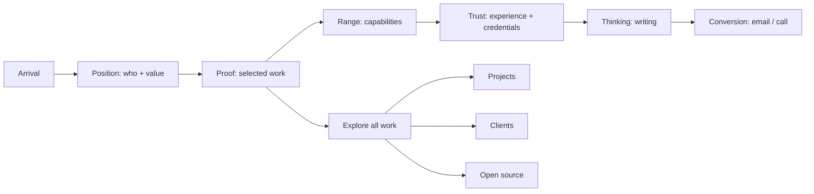
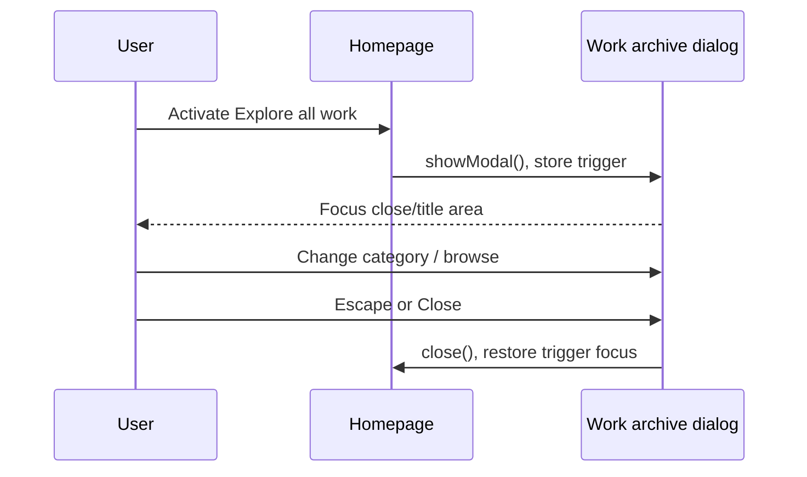
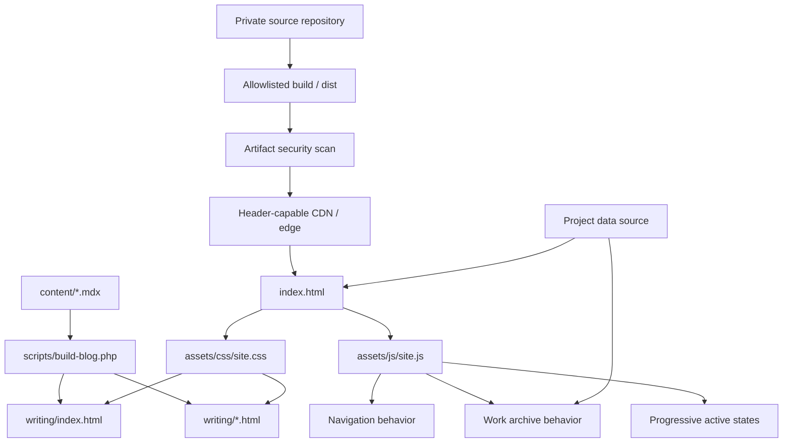

# Design — Portfolio Experience Remake

Status: Draft for approval  
Requirements: [`requirements.md`](./requirements.md)  
Reference direction: CrowdStrike-inspired presentation quality, adapted to a personal software engineering portfolio

## 1. Executive direction

The redesign is a **proof-led engineering narrative** with a visual character described as:

> Editorial command center — sharp, high-contrast, technical, human, and outcome-focused.

The result should borrow CrowdStrike's confidence and pacing, not its identity. The site should feel like one experienced engineer with range, not a cybersecurity vendor and not a generic personal landing page.

## 2. Current-state audit

### What should be preserved

- Clear black/red/off-white palette foundation.
- Strong name recognition and concise value proposition.
- Real project media and substantial project archive.
- Existing analytics, metadata, canonical URL, articles, CV, and profile links.
- Native dialog semantics and the current project/client/open-source dataset.
- Static HTML/CSS/vanilla-JS implementation.
- Cinematic red portrait asset as recognizable personal identity.

### What currently weakens the experience

| Area | Current pattern | UX/design issue | Remake response |
|---|---|---|---|
| Hero | Large name + rounded portrait console | Two focal points compete; portrait feels like a card added beside the copy | Integrate portrait into one edge-to-edge composition with signal rails and proof metadata |
| Selected work | Horizontal carousel inside generic browser frames | Requires interaction before comparison; every project inherits the same visual template | Use stacked case snapshots with alternating media/content and a scannable project index |
| Proof | Number strip detached from projects | Metrics lack nearby evidence and narrative context | Attach relevant proof to case snapshots; retain one compact proof rail for global facts |
| Capabilities | Numbered list after a separate impact section | Structurally sound but visually isolated | Connect capabilities to named proof and use a dark/light split command module |
| Credentials | Auto-moving marquee | Constant movement competes with reading and gives secondary content too much prominence | Use static, dense credential matrix or horizontal manual rail on small screens |
| Work archive | Full-height dialog with tabs | Rich data is hidden behind one button and weakly linkable | Keep progressive-enhanced drawer, add non-JS fallback and grouped scan pattern |
| Narrative | Hero → carousel → metrics → capabilities → credentials | Feels like assembled sections rather than one argument | Reorder into Position → Proof → Range → Trust → Thinking → Contact |
| Geometry | Rounded portrait, rounded project cards, shadows | Soft SaaS-template cues conflict with sharper reference direction | Hard edges, thin rules, clipped accents, minimal shadow |
| Writing | Standard three-row list | Useful but not visually tied to expertise | Introduce topic labels and one featured article, then compact rows |

### 2.1 Security baseline discovered during audit

- Production is currently served directly by GitHub Pages.
- The observed production response does not include a site-controlled CSP, HSTS, anti-clickjacking policy, `X-Content-Type-Options`, `Referrer-Policy`, or `Permissions-Policy`.
- The Pages workflow uploads `path: '.'`, which makes the deploy boundary broader than the intended public website.
- The site loads both Google Analytics and GoatCounter, increasing third-party script and data exposure surface.
- `robots.txt` currently allows every crawler and does not express an AI-training/grounding policy.
- The homepage advertises a public `llms.txt` specifically formatted as profile context for AI assistants.
- Portrait source/master files currently live under the public asset tree; the remake must distinguish publishable derivatives from private masters.

These findings do not prove that the site is compromised. They define the security work required before the remake is considered production-ready.

### 2.2 Threat model

| Threat | Likelihood | Impact | Primary controls | Residual limitation |
|---|---:|---:|---|---|
| Accidental publication of private files | Medium | High | Dedicated `dist/` allowlist, artifact inspection, secret/private-file scan | A mistakenly allowlisted file can still ship |
| Repository or deployment takeover | Low–medium | High | Passkey/MFA, branch/environment protection, least privilege, pinned actions, domain verification | Account recovery and provider compromise remain external risks |
| Malicious/injected third-party script | Medium | High | Minimize vendors, strict CSP, no `unsafe-eval`, hashes/nonces where needed | An explicitly trusted vendor can still be compromised |
| Clickjacking | Medium | Medium | `frame-ancestors 'none'` response header | Requires header-capable delivery layer |
| Cross-site data/referrer leakage | Medium | Medium | Referrer Policy, Permissions Policy, limited analytics, outbound-link hygiene | Destination sites still receive intentional navigation data |
| AI training/grounding crawl | High | Medium | `Google-Extended` and selected crawler opt-outs | Only compliant crawlers honor robots policy |
| Manual AI upload, screenshot, or image editing | High | Medium–high | Web-sized derivatives, metadata stripping, provenance, reporting process | Cannot be technically prevented for public content |
| Impersonation/fake profiles | Medium | High | Canonical identity, official-profile block, JSON-LD, security/contact channel | Platforms and users must still act on reports |
| Image hotlinking/automated scraping | Medium | Low–medium | Edge rate limiting/bot controls, optional hotlink policy | Referrer spoofing and distributed scraping remain possible |
| Dependency/action supply-chain compromise | Low–medium | High | Full-SHA pinning, Dependabot review, minimal CI permissions | Maintainer review is still required |

## 3. Reference translation

Snapshot reviewed on 25 October 2026:

- [CrowdStrike homepage](https://www.crowdstrike.com/)
- [Falcon Platform](https://www.crowdstrike.com/en-us/platform/)
- [Resource Center](https://www.crowdstrike.com/en-us/resources/)

### Patterns to adapt

- A commanding hero with one dominant promise and a direct CTA.
- Dense but readable navigation hierarchy.
- Strong alternation between black, white, and high-signal color fields.
- Oversized typography paired with small operational labels.
- Modular storytelling in which each block has a distinct job.
- Proof and trust placed close to the claims they support.
- Sharp directional elements, rules, and active-state accents.
- Resource content presented as a browsable expertise layer.

### Patterns explicitly excluded

- CrowdStrike wordmarks, falcon imagery, proprietary fonts, copy, product UI, diagrams, gradients, threat visuals, and branded iconography.
- Enterprise mega-menu complexity inappropriate for a personal portfolio.
- Sales pricing cards, analyst badges, testimonials, or customer quotes without equivalent portfolio evidence.
- Cybersecurity language that changes Yogi's professional positioning.

## 4. Experience architecture



### Primary visitor paths

**Fast evaluation path**  
Hero → proof rail → first two selected projects → contact.

**Deep evaluation path**  
Hero → all selected projects → capabilities → work archive → CV/contact.

**Technical content path**  
Hero/navigation → writing index → article → related/next article → contact or home.

## 5. Information architecture

### Homepage

1. Global navigation
2. Hero / identity command module
3. Global proof rail
4. Selected work / case snapshots
5. Capability matrix / “How I contribute”
6. Experience and trust layer
7. Writing / ideas from the work
8. Contact command module
9. Utility footer

### Work archive

- Featured / active products
- Enterprise & international
- Web applications
- Mobile applications
- Private/client work
- Products & prototypes
- Open-source tools
- Client/partner index with relationship context

### Writing

- Writing index with topic labels and chronological archive
- Article template with reading progress optional only if implemented accessibly
- Previous/next or related article links

## 6. Homepage composition

### 6.1 Global navigation

Desktop uses a 72px black rail. `YA/W` anchors the left. Work, Expertise, Writing, and Contact appear on the right; Contact is the only full red action. A thin bottom border and a compact role label create structure without a mega-menu.

Mobile uses a 60px bar with `YA/W`, Contact, and a menu trigger. The opened menu is an opaque full-width panel under the bar, not a floating rounded sheet. Body scroll locks while open; Escape closes it; focus returns to the trigger.

### 6.2 Hero — identity command module

Desktop composition:

```text
┌──────────────────────────────────────────────────────────────────────┐
│ SOFTWARE ENGINEER / BALIKPAPAN                      AVAILABLE / 2026 │
│                                                                      │
│ YOGI ARIF                                      ┌──── signal grid ───┤
│ WIDODO.                     portrait cutout →  │ 09+ YEARS           │
│                                                                      │
│ I build products people use and systems        PRODUCT / SYSTEMS     │
│ teams can rely on.                              / CLOUD / APPLIED AI  │
│                                                                      │
│ [EXPLORE SELECTED WORK ↗]  [BOOK A CALL]                             │
├──────────────────────────────────────────────────────────────────────┤
│ 10+ PRODUCTS  /  TEAM 2→11  /  20-YEAR SYSTEM  /  200+ UI DESIGNS  │
└──────────────────────────────────────────────────────────────────────┘
```

Design notes:

- Hero background is predominantly black, making the red-lit cutout native to the scene.
- The name remains the dominant object. Portrait sits behind/beside the right-side signal grid, with no rounded container.
- Large cropped red geometry may extend from the right edge, but it cannot resemble CrowdStrike's falcon mark.
- Labels use operational language derived from real scope: Product Engineering, System Modernization, Cloud Operations, Applied AI.
- Global proof rail becomes part of the hero boundary, resolving the current disconnect between hero and metrics.
- Mobile order: metadata → name → value statement → actions → portrait/signals → proof list.

### 6.3 Selected work — case snapshots

Replace the current carousel with a vertically progressive case-study sequence.

Each project module uses this content contract:

```text
Project number + category
Project title
One-sentence context
Contribution (what Yogi did)
Outcome or verified scope
Stack / role metadata
Primary visual
Optional live-project CTA
```

Proposed sequence:

1. **YoCateTin** — active founder-led product; hero-sized visual with content over a white/red split.
2. **Japan enterprise platform** — modernization proof; dark module with a before/after or system-scale narrative using existing screenshot and verified `20-year-old`, `200+ UI designs`, MySQL→Oracle scope.
3. **SAL maritime operations** — video/media-led operational system proof; preserve user-controlled playback.
4. **YoClipper** — optional compact module, included only if its contribution adds a distinct applied-AI story.

Modules alternate visual placement but keep DOM order consistent: heading/content precedes media. CSS controls desktop placement.

At the end, a high-contrast `Explore all work` row opens the work archive. The row also has a real fallback target such as `#work-archive-fallback` or a dedicated `work/` page if that is introduced later.

### 6.4 Capability matrix

Use a 40/60 split:

- Left: red field or black field with `Build. Modernize. Keep it running.`
- Right: four full-width rows with number, capability, explanation, and named proof.
- On hover/focus, only the active row's rule and proof link change; no hidden essential content.
- Technology stack remains a small terminal-like metadata line at the bottom, without fake command animation.

### 6.5 Experience and trust layer

Combine fragmented background/certification sections into one trust layer:

- **Experience signals:** years, team growth, international scope, product/client range.
- **Education:** Informatics Engineering, Politeknik Negeri Samarinda, GPA.
- **English:** ICEE program completion; TOEFL-equivalent result only if separately and correctly labeled.
- **Learning:** static 2×3 credential matrix on desktop; manual horizontal rail on narrow screens.
- **Clients/partners:** move to work archive by default. If retained on homepage, display as a quiet monochrome row with a `Selected client work` label and no endorsement language.

### 6.6 Writing

Use one featured article and two compact rows:

```text
┌──────────────────────────────┬──────────────────────────────┐
│ FEATURED / INFRASTRUCTURE    │ 2026-02-08 / TOOLING        │
│ Large title + summary        │ Article title →             │
│ Read article ↗               ├──────────────────────────────┤
│                              │ 2026-02-01 / AI SYSTEMS     │
│                              │ Article title →             │
└──────────────────────────────┴──────────────────────────────┘
```

No decorative thumbnails are required. Strong typography and red directional states provide the visual distinction.

### 6.7 Contact command module

End with a deliberate conversion block, not only a quiet signature:

- Heading: `Have a system to build—or one to modernize?`
- Primary action: Email Yogi.
- Secondary action: Book a call.
- Metadata: location, timezone/working preference if approved, LinkedIn, GitHub, CV.
- The small utility footer below contains copyright/name, role, and back-to-top.

## 7. Visual system

### 7.1 Color tokens

```css
:root {
  --color-black: #050505;
  --color-black-raised: #111111;
  --color-paper: #f2f0ea;
  --color-white: #ffffff;
  --color-ink: #111111;
  --color-muted-light: #b7b7b7;
  --color-muted-dark: #5f5f5f;
  --color-line-light: #d0cec8;
  --color-line-dark: #333333;
  --color-signal: #e51b2b;
  --color-signal-hover: #bd101f;
  --content-max: 1440px;
  --reading-max: 72ch;
  --space-gutter: clamp(20px, 4vw, 72px);
}
```

Color ratios must be validated; token names describe function rather than copying a brand palette.

### 7.2 Typography

- Use local/system sans only for initial implementation; no runtime font request.
- Display style: 750–900 weight, line-height 0.82–0.95, negative tracking calibrated per breakpoint.
- Body: 16–18px, line-height 1.55–1.7, max 65–72ch.
- Metadata: 11–13px, uppercase, 0.10–0.18em tracking.
- Numbers: tabular numerals where supported.
- Do not uppercase long headings or paragraphs.
- Clamp values must never force clipping at 320px or 200% zoom.

### 7.3 Geometry

- Primary modules: 0–4px radius.
- Media: 0–8px radius only where crop quality needs it.
- Buttons: 0–2px radius, 48–56px height.
- Status badge: pill allowed.
- Borders: 1px rules; 2–4px signal bars only for directional emphasis.
- Shadow: omitted by default; use one subtle elevation only for sticky navigation or dialog separation.
- Replace browser dots and ornamental card chrome with real labels and project numbering.

### 7.4 Imagery

- Preserve the cinematic-red portrait without grayscale, blend mode, or color filter.
- Prefer actual product/project visuals over abstract graphics.
- Use `object-fit` intentionally per asset; do not crop away meaningful UI.
- Video remains user-controlled and receives a poster.
- If a project lacks a good image, create a typographic system diagram from verified metadata rather than a fake product mockup.

## 8. Interaction model

### Navigation

- Sticky header transitions from transparent/black-integrated to opaque black after leaving hero only if this can be done without layout shift.
- Active nav state may track visible section via `IntersectionObserver`; navigation still works without it.

### Work archive



- Native `<dialog>` is acceptable.
- Tab arrows follow ARIA tabs behavior; Tab moves into panel content.
- The archive uses grouped rows or an asymmetric grid, not uniform cards for every item.
- Deep-linkable state is optional for this phase; fallback content is mandatory.

### Motion

- Hero content can reveal in three grouped steps: metadata, identity/value, actions/proof.
- Project modules reveal only once and remain static afterward.
- Hover motion is limited to 2–4px directional translation or rule expansion.
- No autoplay carousel, marquee, cursor follower, parallax, or looping decorative animation.

## 9. Responsive layout

| Breakpoint | Layout behavior |
|---|---|
| `≥1280px` | Full asymmetrical hero; 12-column project compositions; 1440px max canvas |
| `900–1279px` | Hero remains two-zone; proof rail may wrap 2×2; project modules use 5/7 or 6/6 split |
| `600–899px` | Single-column hero; portrait integrated after actions; modules become stacked; nav uses mobile menu |
| `<600px` | 20px gutter; actions stack; proof becomes rows; media uses edge-to-edge treatment; credential rail manually scrolls |

Rules:

- Breakpoints respond to content, not device names.
- Project text appears before media in DOM.
- No text is visually placed over detailed screenshots on mobile.
- Navigation, CTA labels, and project metadata may wrap but never truncate.
- At zoom 200%, layout may switch to mobile pattern early.

## 10. Content model

The current project array in `assets/js/showcase.js` should become the source of truth or be generated from a source-of-truth file.

Proposed project schema:

```js
{
  slug: "japan-enterprise-platform",
  title: "Japan enterprise platform",
  group: "enterprise-international",
  featured: true,
  order: 2,
  context: "...",
  contribution: "...",
  outcome: "...",
  impactLabel: "System modernization · Confidential client",
  stack: ["Laravel 7", "Vue.js", "Oracle 12c"],
  media: { type: "image", src: "...", alt: "..." },
  href: null,
  confidential: true
}
```

Implementation options, in preferred order:

1. Keep data in one JS file and render archive progressively while selected work remains meaningful static HTML.
2. Extend `scripts/build-blog.php` or add a small build script that renders both homepage and archive from data.
3. Do not introduce a runtime fetch or CMS for this phase.

## 11. Technical architecture



### File strategy

- `index.html`: semantic homepage content and non-JS fallback.
- `assets/css/site.css`: shared tokens, layout primitives, homepage, archive, writing, article styles.
- `assets/js/site.js` or retained `showcase.js`: navigation, archive, and progressive enhancements only.
- `content/`: remains writing source.
- `scripts/build-blog.php`: updated only when shared article markup/classes must change.
- Existing generated writing HTML must be regenerated, not hand-edited one by one.
- `dist/` or equivalent: the only deployment input. It is created from an explicit allowlist and is never the repository root.
- Private portrait masters, raw credentials, `.kiro`, `.github`, source-only content, and local tooling remain outside the deployment artifact.

### Resilience

- Core content is present in HTML.
- JS failure only removes enhancements, not selected work, navigation links, or contact actions.
- Images reserve layout space through width/height or `aspect-ratio`.
- The dialog never becomes the only route to understand work.

## 12. Accessibility design

- Add a visible skip link.
- Preserve one `main` landmark and logical section headings.
- Use links for navigation and buttons for state changes/dialog controls.
- Use `aria-current` only for actual current page/state.
- Tabs follow the WAI-ARIA keyboard pattern if retained.
- Do not put meaningful text only in pseudo-elements.
- Red is never the only active/error indicator; pair it with weight, rule, icon, label, or position.
- Portrait alt text is concise; decorative signal graphics are hidden.
- Video has accessible label and user controls. Transcript is recommended when spoken content exists.
- Focus remains visible against black, white, paper, and red surfaces.
- Test forced-colors mode and reduced-motion behavior.

## 13. Performance design

- Keep first viewport HTML/CSS small and dependency-free.
- The hero portrait may load eagerly if it is an LCP candidate; selected first project media should not compete at high priority.
- Use WebP/AVIF only where source quality remains acceptable; keep fallback if needed.
- Lazy-load all below-fold project/credential media.
- Avoid `filter`, large blurred shadows, fixed background images, and continuously animated transforms.
- Defer JavaScript and avoid DOM duplication for desktop/mobile variants.
- Audit the red cinematic portrait PNG; serve a compressed transparent WebP/AVIF derivative if it materially reduces bytes without edge artifacts.

## 14. SEO and analytics

- Preserve canonical host, GA, GoatCounter, JSON-LD, verification tag, `robots.txt`, `sitemap.xml`, and CNAME.
- Update `dateModified` only when the remake ships.
- Add a dedicated 1200×630 social preview in a later asset task or during implementation if time allows.
- Keep one descriptive `h1` per page and meaningful page titles/descriptions.
- Track only useful conversions if new events are added: selected-work CTA, email, booking, CV, and archive open. Do not add a new analytics vendor.

## 15. Security, privacy, and AI-abuse architecture

### 15.1 Deployment boundary

The recommended release path is:

```text
source repository
  → deterministic build/copy into clean dist/
  → fail-closed allowlist check
  → secret/private-file scan
  → immutable Pages artifact
  → header-capable CDN/edge
  → public site
```

The workflow must stop uploading `.`. A clean temporary `dist/` should contain only:

- public HTML;
- required CSS and JavaScript;
- optimized public images/video/posters;
- CV explicitly approved for publication;
- `robots.txt`, `sitemap.xml`, CNAME-equivalent routing data where required;
- `/.well-known/security.txt`;
- explicitly approved verification files.

The build must fail if the artifact contains `.git`, `.github`, `.kiro`, `.env*`, key/certificate formats, editor zone metadata, raw credentials, source documents, or filenames matching a denylist. The allowlist is the main control; the denylist is defense in depth.

### 15.2 Hosting and response headers

Direct GitHub Pages is retained as source/origin only if desired. Because the current production response does not provide the required site-controlled headers, route production through a header-capable CDN/edge or migrate the static output to a host that supports response-header configuration.

Target baseline:

| Header | Initial policy |
|---|---|
| `Content-Security-Policy` | Exact source allowlist; `object-src 'none'`; `base-uri 'self'`; `frame-ancestors 'none'`; restrictive `form-action`; no `unsafe-eval` |
| `X-Frame-Options` | `DENY` as legacy defense in depth alongside CSP `frame-ancestors 'none'` |
| `Strict-Transport-Security` | `max-age=31536000`; add `includeSubDomains` only after every subdomain is HTTPS; do not preload initially |
| `X-Content-Type-Options` | `nosniff` |
| `Referrer-Policy` | `strict-origin-when-cross-origin` |
| `Permissions-Policy` | Disable camera, microphone, geolocation, payment, USB, and other unused capabilities |
| `Cross-Origin-Opener-Policy` | Evaluate `same-origin`; ship only after Calendly/outbound-flow regression testing |

CSP rollout must use `Content-Security-Policy-Report-Only` first, review violations, then enforce. The current inline analytics bootstrap must be moved to a local external script or protected with an immutable hash. Never solve CSP errors by adding a blanket `unsafe-inline` or wildcard source.

`frame-ancestors` must be delivered as a response header; a meta CSP cannot provide complete anti-clickjacking protection.

### 15.3 Third-party scripts and analytics

- Inventory every third-party origin and document its purpose.
- Prefer one analytics solution instead of both Google Analytics and GoatCounter; default recommendation is the smallest privacy/security surface that still meets measurement needs.
- If Google Analytics remains, allow only its exact script, connection, and image endpoints required by observed production traffic.
- If GoatCounter remains, load it asynchronously and allow only its exact origin/endpoints.
- Do not add chat widgets, session replay, fingerprinting, or remote animation libraries.
- Subresource Integrity may be used only for versioned immutable resources that provide compatible CORS headers; it is not forced onto mutable analytics loaders where it would create false confidence or break updates.

### 15.4 Repository, CI, and domain controls

- Require passkey/MFA for the GitHub and domain-registrar accounts.
- Protect the production branch and GitHub Pages environment with reviewed changes where the account/repository plan supports it.
- Keep `GITHUB_TOKEN` permissions at the job/workflow minimum.
- Pin every GitHub Action to a reviewed full commit SHA; use Dependabot to propose controlled updates.
- Keep secrets out of client code and logs. Static sites have no private runtime secret boundary.
- Verify the custom domain in GitHub, enable HTTPS enforcement, registrar lock, auto-renew, and DNSSEC when supported.
- Consider CAA records once the certificate delivery path is finalized.
- Maintain a documented recovery path: registrar access, DNS access, GitHub recovery codes, known-good commit, and emergency deployment owner.

### 15.5 AI crawler policy

Recommended baseline keeps normal search indexing while opting out of Google's AI reuse control:

```text
User-agent: *
Allow: /

User-agent: Google-Extended
Disallow: /

Sitemap: https://yogiarifwidodo.my.id/sitemap.xml
```

Google documents that `Google-Extended` controls whether crawled site content may be used for future Gemini model training and Gemini/Vertex AI grounding, while not affecting Google Search inclusion or ranking. This does **not** block a person from downloading an image or uploading a screenshot to Gemini.

Additional AI-training crawler tokens may be denied after reviewing their current official documentation. The list must be maintained; do not copy an unverified giant bot list. `robots.txt` is public policy for compliant crawlers, never access control for confidential material.

The current `llms.txt` contains useful anti-hallucination guidance, but it deliberately packages the profile for AI consumption and has no enforcement power. Under the recommended strict AI-minimization posture, remove its `<link rel="alternate">` and exclude the file from the public artifact. Canonical URLs, structured data, and official-profile links remain the public identity source. If the owner later prioritizes accurate AI citation over AI minimization, republishing a reduced `llms.txt` must be an explicit policy change.

### 15.6 Personal image and provenance policy

- Store original portrait/master assets outside the public artifact.
- Publish only a web-sized derivative close to the largest rendered requirement, plus a smaller responsive candidate.
- Strip EXIF, GPS, camera, editing-history, and unnecessary profile metadata before publishing.
- Keep an internal checksum and source record for the original and published derivative.
- Use canonical URL, `Person` JSON-LD, `sameAs`, and an `Official profiles` block as public identity anchors.
- Add a concise copyright/usage notice. An optional subtle signature may deter casual reuse but is not a security control.
- Do not disable context menus, block selection, overlay the image with transparent elements, or use hostile scripts; these do not stop determined copying and harm usability/accessibility.
- If abuse occurs, retain evidence, report the impersonating account/content to the platform, use applicable copyright/privacy reporting channels, and publish a clarification through official profiles when warranted.

### 15.7 Security reporting and incident response

Publish `/.well-known/security.txt` following RFC 9116 with:

- `Contact` using a monitored security email or HTTPS contact URL;
- `Expires` refreshed before expiry;
- `Canonical` pointing to the production file;
- optional `Preferred-Languages: id, en`.

Minimum incident playbook:

1. Preserve evidence and identify whether the issue is repository, deployment, domain, third party, or impersonation.
2. Revoke affected tokens/sessions and rotate any exposed credentials.
3. Restore from a reviewed known-good commit and invalidate CDN cache.
4. Remove malicious/unintended files and verify headers/artifact again.
5. Notify affected parties only when facts and scope are understood.
6. Document root cause and add a regression check.

### 15.8 Primary references

- [Google common crawlers — Google-Extended](https://developers.google.com/search/docs/crawling-indexing/google-common-crawlers#google-extended)
- [Google robots meta and X-Robots-Tag specification](https://developers.google.com/search/docs/crawling-indexing/robots-meta-tag)
- [MDN Content Security Policy guide](https://developer.mozilla.org/en-US/docs/Web/HTTP/Guides/CSP)
- [MDN Referrer-Policy](https://developer.mozilla.org/en-US/docs/Web/HTTP/Headers/Referrer-Policy)
- [OWASP Secure Headers Project](https://owasp.org/www-project-secure-headers/)
- [GitHub Pages HTTPS guidance](https://docs.github.com/en/pages/getting-started-with-github-pages/securing-your-github-pages-site-with-https)
- [GitHub Actions security hardening](https://docs.github.com/en/actions/security-guides/security-hardening-for-github-actions)
- [GitHub Dependabot version updates](https://docs.github.com/en/code-security/dependabot/dependabot-version-updates/configuring-dependabot-version-updates)
- [RFC 9116 — security.txt](https://www.rfc-editor.org/rfc/rfc9116)

## 16. Validation strategy

### Automated

- HTML validation for homepage, writing index, and representative article.
- Internal asset/link scan.
- JavaScript syntax check.
- CSS parse/build check if available.
- Lighthouse mobile and desktop snapshots.
- Accessibility audit with axe or equivalent if available.

### Manual

- Keyboard-only path: skip link → nav → hero actions → selected work → archive → tabs → close → writing → contact.
- Screen widths: 320, 375, 768, 1024, 1440px.
- Zoom: 200% at desktop width.
- Motion: normal and reduced.
- JS disabled: navigation, selected work, writing, contact, and fallback archive remain usable.
- Long-title and wrapping checks on project/article content.
- Real device/touch check for mobile menu and horizontal credential overflow.

### Security and privacy

- Inspect the final deployment artifact and fail if any source/private/secret-pattern file is present.
- Fetch production response headers and compare them with the approved baseline.
- Run CSP in report-only mode before enforcement, then retest analytics and outbound flows.
- Confirm HTTPS redirect/enforcement, no mixed active content, and no third-party origin outside the inventory.
- Verify `robots.txt` leaves approved search crawling intact and contains the current AI crawler policy.
- Inspect public images for EXIF/GPS metadata and confirm master assets are absent from the artifact.
- Verify `security.txt` is reachable at the well-known path and has a future expiry.
- Run dependency/action review and a static secret scan before release.

## 17. Rollout and risk control

- Implement behind the current static files in one branch/commit series.
- Preserve current working version until the new homepage, writing templates, and archive pass QA together.
- Do not delete existing assets until link scanning proves they are unused.
- Treat copy verification and confidential-client review as a release gate.
- Roll out CSP as report-only, then enforce after violations are resolved.
- Treat security headers, allowlisted artifact generation, master-image exclusion, and account/domain controls as release gates, not post-launch enhancements.
- Deployment is out of scope for this spec-only phase.

## 18. Requirement traceability

| Requirement | Primary design sections |
|---|---|
| R1 | 6.2, 7.4 |
| R2 | 4, 6.3, 6.5 |
| R3 | 6.3, 10 |
| R4 | 5, 8, 11 |
| R5 | 6.4 |
| R6 | 6.5 |
| R7 | 5, 6.6, 11 |
| R8 | 6.1, 6.7, 8 |
| R9 | 3, 7 |
| R10 | 8 |
| R11 | 9, 12, 16 |
| R12 | 11, 13, 16 |
| R13 | 10, 17 |
| R14 | 2.1, 2.2, 11, 15, 16, 17 |
| R15 | 2.2, 15, 16, 17 |

