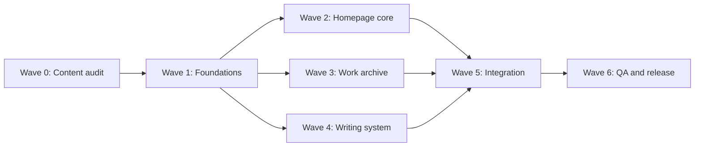

# Implementation Plan — Portfolio Experience Remake

Status: Not started  
Requirements: [`requirements.md`](./requirements.md)  
Design: [`design.md`](./design.md)

## Execution rules

- Do not begin implementation until requirements and design direction are approved.
- Preserve unrelated working-tree changes.
- Do not invent or strengthen claims while rewriting copy.
- Keep the existing static HTML/CSS/vanilla-JS stack.
- Regenerate writing pages from the source/build path; do not manually patch every generated article.
- Treat `robots.txt` as crawler policy, never as protection for sensitive files.
- Never publish repository root; deploy only a clean, inspected public artifact.
- A task is complete only after its stated verification passes.

## Dependency waves

Wave 2, Wave 3, and Wave 4 may run independently after Wave 1, but shared CSS contracts must be agreed first.

## Wave 0 — Content and asset audit

- [x] 0.1 Build a verified claims ledger
  - Map every homepage metric and major statement to its source in the current site, CV, or repository content.
  - Flag ambiguous claims such as `10+ products`, client relationship wording, and availability date.
  - Record confidential-client restrictions.
  - Output: a short table inside the implementation PR/notes or a dedicated local content note.
  - Requirements: R2, R13.

- [x] 0.2 Confirm selected-work lineup and narrative
  - Confirm YoCateTin, Japan enterprise platform, and SAL maritime operations.
  - Decide whether the fourth slot is YoClipper or another international project.
  - For each selected project, approve Context → Contribution → Outcome/Scope copy.
  - Requirements: R2, R3, R13.

- [x] 0.3 Audit asset quality and weight
  - Record dimensions, format, file size, transparency, and meaningful crop for hero and selected-project media.
  - Identify missing poster/fallback assets.
  - Decide whether a transparent WebP/AVIF portrait derivative is needed.
  - Identify public derivatives versus private/master assets and inspect personal images for EXIF/GPS metadata.
  - Requirements: R3, R9, R12, R15.

- [x] 0.4 Resolve credential wording
  - Separate ICEE program completion from the TOEFL-equivalent result.
  - Label course completions, badges, and certifications accurately.
  - Verify which credential logos may remain visible.
  - Requirements: R6, R13.

- [x] 0.5 Complete security and privacy inventory
  - Inventory public files, third-party origins, analytics data flows, GitHub Actions, production branch/environment, domain provider, and DNS path.
  - Confirm which portrait/credential files must never enter a deployment artifact.
  - Record current production response headers as the before-state.
  - Choose the approved analytics vendor(s) and AI crawler policy.
  - Requirements: R14, R15.

## Wave 1 — Shared foundations

- [x] 1.1 Create the final token system and layout primitives
  - Replace ad-hoc values with semantic color, spacing, typography, border, timing, and canvas tokens.
  - Add reusable primitives for full-bleed sections, content grids, metadata labels, rules, actions, and media frames.
  - Remove soft-card defaults from shared components.
  - Verify black/white/paper/red contrast combinations.
  - Requirements: R9, R10, R11.

- [x] 1.2 Establish shared document accessibility
  - Add a visible-on-focus skip link.
  - Verify landmarks, heading rules, focus tokens, target sizes, and forced-colors behavior.
  - Add reduced-motion rules before component motion is introduced.
  - Requirements: R10, R11.

- [ ] 1.3 Define one project data contract
  - Normalize project fields for slug, group, featured order, context, contribution, outcome, stack, media, link, and confidentiality.
  - Remove duplicated or conflicting copy between homepage and work archive.
  - Keep meaningful static selected-work HTML for no-JS use.
  - Requirements: R3, R4, R12, R13.

- [x] 1.4 Build responsive navigation shell
  - Implement desktop rail and accessible mobile menu.
  - Add Escape close, focus handling, body-scroll behavior, and non-JS usable links.
  - Prevent sticky header from obscuring anchored headings.
  - Requirements: R8, R10, R11.

- [x] 1.5 Create a fail-closed public artifact build
  - Generate a clean `dist/` or equivalent from an explicit allowlist.
  - Include only approved HTML, runtime assets, public CV, routing/verification files, sitemap, robots policy, and security contact.
  - Fail on private/source paths, secret/key patterns, editor metadata, raw credentials, and master portrait assets.
  - Change Pages upload input from repository root to the inspected artifact.
  - Requirements: R12, R13, R14, R15.

- [ ] 1.6 Define the security header policy and delivery layer
  - Decide between a header-capable CDN/edge in front of GitHub Pages or migration to a static host that supports response headers.
  - Draft CSP from the actual third-party inventory; prohibit `unsafe-eval` and avoid wildcard sources.
  - Define HSTS, `nosniff`, `frame-ancestors`, Referrer Policy, and Permissions Policy values.
  - Create a CSP report-only rollout and rollback plan.
  - Requirements: R14.

## Wave 2 — Homepage core

- [x] 2.1 Rebuild the hero as an identity command module
  - Compose name, role/location, value proposition, availability, actions, portrait cutout, signal grid, and global proof rail as one section.
  - Remove the rounded portrait card and competing profile-console chrome.
  - Preserve portrait color treatment without CSS filters or overlays.
  - Ensure primary CTA is visible at desktop height 720px.
  - Verify 320px, 768px, 1024px, 1440px, and 200% zoom.
  - Requirements: R1, R2, R8, R9, R11.

- [x] 2.2 Replace the selected-work carousel with case snapshots
  - Build 3–4 vertical modules using the approved content contract.
  - Alternate composition via CSS while keeping content-first DOM order.
  - Remove browser-window dots, generic card chrome, and carousel-only discovery.
  - Preserve user-controlled SAL video and live-product links.
  - Add an `Explore all work` action with a no-JS fallback.
  - Requirements: R2, R3, R4, R9, R10.

- [x] 2.3 Rebuild capability matrix
  - Implement the dark/red and light split composition.
  - Connect each capability to named, verified proof.
  - Keep technology stack as quiet metadata.
  - Ensure hover, focus, and touch reveal the same information.
  - Requirements: R5, R9, R11.

- [x] 2.4 Consolidate experience and trust layer
  - Merge proof, education, English credential, and continuing learning into one intentional hierarchy.
  - Replace the autoplay credential marquee with a static matrix/manual narrow-screen rail.
  - Move client logos to the archive unless homepage inclusion is explicitly approved.
  - Requirements: R2, R6, R10, R13.

- [x] 2.5 Recompose homepage writing preview
  - Render one featured article and two compact article rows.
  - Add accurate topic labels and preserve date/title/summary.
  - Provide a clear All writing route.
  - Requirements: R7, R9.

- [x] 2.6 Add contact command module and utility footer
  - Add one strong closing prompt with Email and Book a call hierarchy.
  - Include location, CV, LinkedIn, and GitHub as utility links.
  - Keep the final footer compact with back-to-top.
  - Requirements: R1, R8, R9.

## Wave 3 — Work archive

- [x] 3.1 Redesign the archive information hierarchy
  - Group content into Active products, Enterprise & international, Web, Mobile, Client/private, Prototypes, Open source, and Clients/partners.
  - Use heterogeneous rows/modules based on content, not identical cards.
  - Ensure all current project data remains discoverable.
  - Requirements: R4, R13.

- [x] 3.2 Implement progressive archive access
  - Keep native dialog if it meets the approved UX.
  - Store and restore trigger focus; support Escape and focus containment.
  - Implement correct ARIA tabs keyboard behavior if tabs remain.
  - Add a readable fallback route/section for JavaScript-disabled use.
  - Requirements: R4, R10, R11, R12.

- [x] 3.3 Improve archive media behavior
  - Reserve image/video dimensions.
  - Lazy-load media and use poster/preload settings appropriately.
  - Ensure outbound links are distinct from archive navigation controls.
  - Requirements: R3, R4, R12.

## Wave 4 — Writing system

- [x] 4.1 Redesign writing index template
  - Add masthead, topic/date/title scan hierarchy, and archive separators.
  - Preserve every existing article and its link.
  - Avoid thumbnail dependency.
  - Requirements: R7, R9, R11.

- [x] 4.2 Redesign article template in the generator
  - Update shared header/back navigation, title/meta block, reading column, code, tables, quotes, images, lists, and link styles.
  - Add next/previous or related navigation if source ordering is reliable.
  - Keep content semantic and comfortable at mobile widths.
  - Requirements: R7, R8, R11.

- [x] 4.3 Regenerate and verify all writing output
  - Run the existing PHP build workflow.
  - Confirm no article is dropped or renamed unexpectedly.
  - Spot-check at least one long technical article, one article with code, and one with media/table content if available.
  - Requirements: R7, R12.

## Wave 5 — Integration and optimization

- [x] 5.1 Add controlled progressive motion
  - Introduce only grouped hero entrance, project reveal, and concise interaction feedback.
  - Keep timings within the motion contract.
  - Verify reduced-motion removes movement and smooth scrolling.
  - Requirements: R10, R11.

- [x] 5.2 Optimize media delivery
  - Compress/derive hero and selected-project assets where needed.
  - Set correct eager/lazy loading, fetch priority, decoding, dimensions, and aspect ratios.
  - Avoid loading hidden archive media before it is likely needed.
  - Requirements: R12.

- [x] 5.3 Preserve and update metadata
  - Preserve GA, GoatCounter, verification, canonical URLs, CNAME, robots, sitemap, and article metadata.
  - Update homepage description/social copy only if it reflects approved positioning.
  - Update structured-data `dateModified` only at release.
  - Requirements: R7, R12, R13.

- [x] 5.4 Remove superseded behavior safely
  - Remove carousel code, autoplay marquee CSS, unused component classes, and genuinely unused assets only after reference scanning.
  - Do not remove unrelated user assets or source content.
  - Verify there are no stale selectors or event listeners.
  - Requirements: R10, R12.

- [ ] 5.5 Harden third-party scripts and browser policy
  - Remove duplicate analytics unless both vendors have an approved, documented purpose.
  - Move inline executable bootstrap code to a local file or protect immutable inline blocks with CSP hashes.
  - Apply the exact CSP source allowlist and test first in report-only mode.
  - Add response security headers through the selected delivery layer.
  - Verify every `_blank` link has opener protection.
  - Requirements: R12, R14.

- [x] 5.6 Implement AI crawler and personal-image policy
  - Preserve normal search crawling and add `Google-Extended: Disallow /`.
  - Add only reviewed additional AI crawler tokens and document their maintenance owner/date.
  - Remove the advertised `llms.txt` link and exclude `llms.txt` from the artifact under the approved strict AI-minimization policy.
  - Publish web-sized portrait derivatives only and strip unnecessary EXIF/IPTC/GPS metadata.
  - Add canonical identity, Official profiles, and concise copyright/usage notice.
  - Do not implement right-click blocking, text-selection blocking, or transparent download overlays.
  - Requirements: R13, R15.

- [ ] 5.7 Harden repository, workflow, domain, and reporting path
  - Pin GitHub Actions to reviewed full commit SHAs and keep minimum token permissions.
  - Configure Dependabot for Action updates and review changes before merge.
  - Verify custom domain, HTTPS enforcement, registrar lock, auto-renew, MFA/passkey, and DNSSEC support.
  - Add `/.well-known/security.txt` with monitored contact, canonical URL, preferred languages, and future expiry.
  - Document known-good rollback and credential/session revocation steps.
  - Requirements: R14, R15.

## Wave 6 — QA and release gate

- [x] 6.1 Run structural and link checks
  - Validate homepage, writing index, and representative articles.
  - Scan internal links, asset paths, anchor targets, outbound project links, CV, email, Calendly, GitHub, and LinkedIn.
  - Run JavaScript syntax checks and the blog build.
  - Requirements: R7, R8, R12.

- [x] 6.2 Complete responsive visual QA
  - Test 320, 375, 768, 1024, and 1440px.
  - Test 200% zoom and long-title wrapping.
  - Confirm no horizontal page overflow and no obscured anchored content.
  - Requirements: R1, R3, R8, R11.

- [x] 6.3 Complete interaction and accessibility QA
  - Test full keyboard path, mobile menu, dialog/archive, tabs, video, focus return, skip link, and reduced motion.
  - Run automated accessibility tooling when available.
  - Test high contrast/forced colors where supported.
  - Requirements: R4, R8, R10, R11.

- [x] 6.4 Complete performance QA
  - Record Lighthouse mobile/desktop results.
  - Verify LCP, CLS, and INP targets or document the measured limitation.
  - Inspect initial network requests for unnecessary fonts, scripts, and below-fold images.
  - Requirements: R12.

- [x] 6.5 Complete content and privacy review
  - Review every visible metric, client reference, confidentiality label, credential label, and outbound document.
  - Confirm raw credential PDF is not public-linked.
  - Confirm CrowdStrike assets/copy have not been copied.
  - Confirm only optimized derivatives of personal images are public and no unnecessary metadata remains.
  - Verify Official profiles and ownership/provenance signals point to canonical accounts.
  - Requirements: R6, R9, R13, R15.

- [ ] 6.6 Complete production security verification
  - Inspect the exact public artifact and fail on private/source/secret-pattern files.
  - Fetch production headers and verify enforced CSP, HSTS policy, `nosniff`, `frame-ancestors`, Referrer Policy, and Permissions Policy.
  - Confirm no mixed active content or unapproved third-party origin.
  - Test analytics, outbound links, social previews, video, and Calendly under enforced CSP.
  - Verify `robots.txt`, `security.txt`, HTTPS, domain ownership, and recovery access.
  - Record accepted residual risks, especially manual screenshot/download and non-compliant crawlers.
  - Requirements: R12, R14, R15.

- [ ] 6.7 Release decision
  - Require all critical acceptance criteria to pass.
  - Document any accepted non-critical gaps.
  - Deploy only after owner approval; deployment is not part of the current spec-only task.

## Definition of done

- Requirements R1–R15 are traceable to implemented code and QA evidence.
- Homepage tells a coherent Position → Proof → Range → Trust → Thinking → Contact story.
- Selected work is understandable without carousel interaction or dialog access.
- Writing index and all generated articles share the new system.
- Site remains usable with keyboard, reduced motion, 200% zoom, and JavaScript disabled.
- No broken internal links, missing articles, console errors, exposed private credentials, or unverified claims.
- Production is deployed from an allowlisted artifact, required response headers are active, and repository root/private masters are absent.
- Normal search discoverability remains intact while the reviewed AI crawler opt-out policy is published.
- Performance and accessibility results are measured and recorded.

